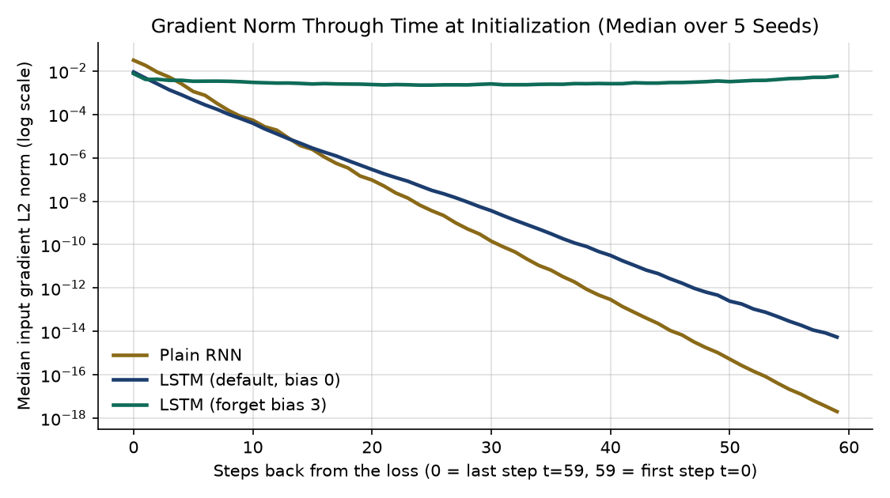

# What Recurrence Can and Cannot Remember

Measuring gradients through time and comparing recurrent cells on a delayed-recall task.

## Task Overview

In the delayed-recall benchmark (`lab04_starter.py`), each sequence has length $T$ and $6$ input features (`4` class features + `2` noise features). At step $t = 0$, the true class label ($4$ classes, chance accuracy $= 0.250$) is encoded as a one-hot vector in the first $4$ features. Every subsequent step $t \in \{1, \dots, T-1\}$ zeroes out the first $4$ features and supplies random Gaussian noise ($\sigma = 0.5$) in the last $2$ features. A linear classification head reads only the final hidden state $h_{T-1}$ (`out[:, -1]`), requiring the recurrent network to transport the step-$0$ label across $T - 1$ noisy steps.

### Gate Slice Confirmation
PyTorch concatenates gate parameters into a single tensor (`bias_ih_l0` and `bias_hh_l0`), where the effective bias is the sum $b_{\text{eff}} = b_{ih} + b_{hh}$:
- **LSTM**: Gate order is `(input, forget, cell, output)`, each of size $H = 32$ (total length $128$). Slice `[32:64]` (`[H:2H]`) corresponds to the **forget gate**.
- **GRU**: Gate order is `(reset, update, new)`, each of size $H = 32$ (total length $96$). Slice `[32:64]` (`[H:2H]`) corresponds to the **update gate**.

Before running the benchmark, `verify_gate_slices()` in `benchmark.py` prints the mean effective bias (`bias_ih_l0 + bias_hh_l0`) of each $H$-wide block and asserts via `torch.allclose` that slice `[32:64]` equals `3.0` while all other gate slices remain near `0.0`:
- `LSTM (forget gate is slice [32:64]): mean effective bias per gate block = [-0.024, 3.0, 0.012, 0.006]`
- `GRU  (update gate is slice [32:64]): mean effective bias per gate block = [0.021, 3.0, -0.008]`

## Setup

```bash
python3 -m venv .venv
source .venv/bin/activate  # Windows: .venv\Scripts\activate
pip install -r requirements.txt
```

## Run

```bash
python benchmark.py      # piece 1: 5 configs x lengths 10, 30, 60 (seeds 0, 1, 2)
python gradients.py      # piece 2: gradient per step (median over 5 seeds), saves gradients.png
python fixes.py          # piece 3: forget-bias sweep and RNN clipping comparison
python timing.py         # piece 4: LSTM forward+backward time against sequence length
```

## Prediction (written before running the clipping comparison)

**What I expected clipping to do for the plain RNN at length 30, and why:**
I don't think turning gradient clipping on or off will help the plain RNN solve the task at a length of 30. Either way, its accuracy will probably stay stuck at a low level. 

*Reasoning:* Gradient clipping caps the global norm of the gradients during backpropagation (`nn.utils.clip_grad_norm_`), which prevents exploding gradients from causing high weight updates. However, on a 30-step delayed-recall task, the signal from step 0 to 29 fails because of vanishing gradients.

## Results

### Piece 1: Benchmark Table (Validation Accuracy; Chance = 0.250)

All runs use identical hyperparameters (`hidden=32`, `steps=600`, `batch_size=64`, `lr=3e-3`, `clip=1.0`, validation seed `999`).

| Configuration | Length | Seed 0 | Seed 1 | Seed 2 | Mean |
| :--- | :---: | :---: | :---: | :---: | :---: |
| Plain RNN | 10 | 0.755 | 1.000 | 0.495 | 0.750 |
| Plain RNN | 30 | 0.248 | 0.251 | 0.264 | 0.254 |
| Plain RNN | 60 | 0.250 | 0.240 | 0.233 | 0.241 |
| LSTM (default) | 10 | 1.000 | 1.000 | 1.000 | 1.000 |
| LSTM (default) | 30 | 0.248 | 0.251 | 0.255 | 0.251 |
| LSTM (default) | 60 | 0.249 | 0.251 | 0.254 | 0.251 |
| LSTM (forget bias 3) | 10 | 1.000 | 1.000 | 1.000 | 1.000 |
| LSTM (forget bias 3) | 30 | 1.000 | 1.000 | 1.000 | 1.000 |
| LSTM (forget bias 3) | 60 | 1.000 | 1.000 | 1.000 | 1.000 |
| GRU (default) | 10 | 1.000 | 1.000 | 1.000 | 1.000 |
| GRU (default) | 30 | 0.241 | 0.257 | 0.254 | 0.251 |
| GRU (default) | 60 | 0.248 | 0.249 | 0.240 | 0.246 |
| GRU (update bias 3) | 10 | 1.000 | 1.000 | 1.000 | 1.000 |
| GRU (update bias 3) | 30 | 1.000 | 1.000 | 1.000 | 1.000 |
| GRU (update bias 3) | 60 | 1.000 | 1.000 | 1.000 | 1.000 |

### Piece 2: Gradient-Through-Time Measurement

Median L2 gradient norm $\left\|\frac{\partial \mathcal{L}}{\partial x_t}\right\|_2$ reaching each input step across 5 seeds (`0, 1, 2, 3, 4`) for a 60-step sequence (`hidden=32`, `batch=16`, `n_inputs=8`) when the cross-entropy loss reads only the final step ($t = 59$):

| Configuration | 0 steps back ($t=59$) | 9 steps back ($t=50$) | 29 steps back ($t=30$) | 59 steps back ($t=0$) |
| :--- | :---: | :---: | :---: | :---: |
| Plain RNN | `3.144e-02` | `8.030e-05` | `3.101e-10` | `2.000e-18` |
| LSTM (default, bias 0) | `9.021e-03` | `6.370e-05` | `5.646e-09` | `5.448e-15` |
| LSTM (forget bias 3) | `7.627e-03` | `3.223e-03` | `2.434e-03` | `5.871e-03` |



### Piece 3: Two Controlled Fixes (Sequence Length 30, Seeds 0, 1, 2)

#### 3A. LSTM Forget-Gate Bias Sweep ($T = 30$)

| Forget Gate Bias | Seed 0 | Seed 1 | Seed 2 | Mean |
| :--- | :---: | :---: | :---: | :---: |
| `bias = 0.0` (default) | 0.247 | 0.251 | 0.258 | 0.252 |
| `bias = 1.0` | 0.495 | 0.496 | 1.000 | 0.664 |
| `bias = 2.0` | 1.000 | 1.000 | 1.000 | 1.000 |
| `bias = 3.0` | 1.000 | 1.000 | 1.000 | 1.000 |

#### 3B. Plain RNN Gradient Clipping Comparison ($T = 30$)

| Clipping Setting | Seed 0 | Seed 1 | Seed 2 | Mean |
| :--- | :---: | :---: | :---: | :---: |
| Clipping ON (`clip=1.0`) | 0.248 | 0.251 | 0.264 | 0.254 |
| Clipping OFF (`clip=None`) | 0.248 | 0.251 | 0.264 | 0.254 |

**Explanation of Piece 3 Results:**
The clipping comparison confirms our pre-run prediction: the Plain RNN remains at chance ($\approx 0.250$) whether gradient clipping is enabled or disabled. As shown in the Piece 2 gradient table, at $29$ steps back ($T=30$), the Plain RNN's input gradient norm has already decayed down to $3.10 \times 10^{-10}$. Clipping scales down large gradients to prevent explosion, but it cannot recover a vanished gradient signal from step $0$. Conversely, in the LSTM forget-bias sweep, default initialization (`bias = 0.0`) fails across all seeds at length 30 ($0.252$ mean), whereas opening the forget gate (`bias >= 2.0`) stabilizes gradient flow from the first update and achieves $1.000$ across all three seeds.

### Piece 4: Limits of Recurrence (Timing & Distance)

#### 4A. LSTM Forward + Backward Pass Timing (Best of 3 Repeats, Batch = 64, Hidden = 32)

| Sequence Length ($T$) | Best Time (ms) | Ratio vs. $T = 50$ |
| :---: | :---: | :---: |
| 50 | 4.63 | 1.00x |
| 100 | 8.79 | 1.90x |
| 200 | 17.34 | 3.74x |
| 400 | 35.60 | 7.68x |

#### 4B. Distance Limit Check (Open-Gate LSTM `bias = 3.0`, 600 Updates, Seed 0)

| Sequence Length ($T$) | Validation Accuracy (Seed 0) | Outcome |
| :---: | :---: | :--- |
| 60 | 1.000 | Solved |
| 100 | 0.252 | Chance (0.250) |
| 200 | 0.251 | Chance (0.250) |

## Conclusion

1. **What gates changed:** A plain RNN overwrites its hidden state at every step via matrix multiplication and $\tanh$, causing gradients to vanish geometrically with distance ($8.03 \times 10^{-5}$ at $9$ steps back, $3.10 \times 10^{-10}$ at $29$ steps back, and $2.00 \times 10^{-18}$ at $59$ steps back). Gated architectures (LSTM and GRU) introduce an additive state update path ($c_t = f_t \odot c_{t-1} + i_t \odot \tilde{c}_t$), creating a potential highway capable of carrying information and gradients across many steps.
2. **What initialization changed:** Having a gated path in the equations is not enough if the gate starts half-closed. At default initialization (`bias = 0`), $\sigma(0) = 0.5$, so the LSTM cell state is multiplied by $\approx 0.5$ at every step, causing its initial gradient at $59$ steps back ($5.45 \times 10^{-15}$) to vanish rapidly. Consequently, the default LSTM fails completely at $T=30$ and $T=60$ ($0.251$ mean). Initializing the forget-gate bias to $3.0$ sets $\sigma(3.0) \approx 0.953$ from update $1$, keeping the gradient at $59$ steps back at $5.87 \times 10^{-3}$ and allowing the LSTM to achieve $1.000$ on all seeds at $T = 10, 30,$ and $60$.
3. **What clipping changed:** Gradient clipping (`clip=1.0` vs. `clip=None`) did not improve the plain RNN at $T = 30$ ($0.254$ vs. $0.254$, both at chance). Clipping bounds exploding gradients so updates do not diverge, but it preserves the relative ratio between step-$0$ and step-$29$ gradients and therefore cannot fix vanishing gradients.
4. **The two limits of recurrence and how direct connections (attention) address them:**
   - **Sequential bottleneck ($O(T)$ serial steps):** Because step $t$ requires $h_{t-1}$, computation cannot be parallelized across the sequence dimension; doubling $T$ from $50 \rightarrow 100 \rightarrow 200 \rightarrow 400$ linearly doubles wall-clock time ($1.00\times \rightarrow 1.90\times \rightarrow 3.74\times \rightarrow 7.68\times$). **Direct connections (self-attention)** remove recurrence so all positions in a layer are computed simultaneously in parallel.
   - **Distance is path length / fixed-size state bottleneck:** Even with `gate_bias = 3.0`, step $0$'s label must survive $T - 1$ intermediate state updates inside a fixed-width vector, causing the open-gate LSTM to drop back to chance ($0.252$) at $T = 100$ and $T = 200$ within a 600-update budget. **Direct connections (attention)** connect every position directly to step $0$ in **one hop** regardless of $T$, making path length $O(1)$ so distance stops mattering (at the cost of $O(T^2)$ time and memory for the attention score matrix).

## Known Limitations

- All training comparisons use a fixed budget of `600` updates, a single learning rate (`3e-3`), and hidden size `32`; an open-gate LSTM could potentially learn beyond $T = 60$ given substantially more updates or hyperparameter tuning.
- In a GRU (`h_t = (1 - z_t) * n_t + z_t * h_{t-1}`), a large positive update-gate bias (`gate_bias = 3.0`, $z_t \approx 0.953$) couples memory retention ($z_t$) with input suppression ($1 - z_t \approx 0.047$), which can slightly dampen writing the initial step-$0$ input compared to an LSTM where the forget and input gates are parameterized independently.